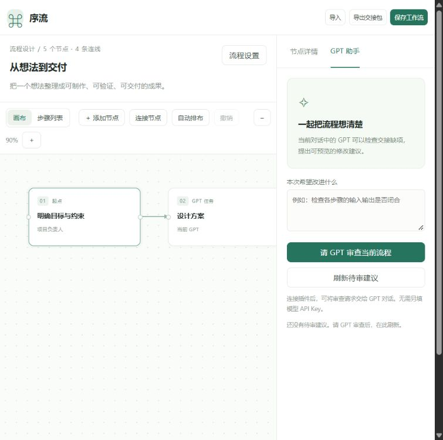

# 序流 · GPT 工作流编排台

这是一个依托当前 ChatGPT／Codex 对话的**通用可视化工作流插件**，包含可运行画布、MCP 工具、MCP Apps 界面资源与 Skill。适用于研究、开发、写作及其他项目，围棋开发流程仅作为示例。

版本：0.1.0。个人本地插件，非 OpenAI 官方产品。

A visual workflow editor for ChatGPT and Codex, with MCP tools, an MCP Apps UI, and reviewable GPT suggestions. Local, single-user, and no separate model API key required.

[下载可直接运行的 v0.1.0 插件包](https://github.com/qingfengyinling/gpt-workflow-studio/raw/refs/heads/main/releases/gpt-workflow-studio-v0.1.0.zip) · [版本记录](CHANGELOG.md) · [测试记录](验收记录.md)



## 可以直接使用的功能

- 新建多个工作流、导入旧编排台单图或 `workflows` 总集。
- 拖动节点，新增、编辑、删除连线，填写分支条件，缩放及自动布局，切换步骤列表。
- 编辑目标、最终交付、约束和节点职责、模型偏好、执行指令、输入输出、验收、禁止项、人工卡点及失败说明。
- 检查循环依赖、重复身份、失效连线及任务契约缺项。
- 将流程交给当前 GPT 审查；候选补丁逐项勾选、预览、应用，整批可以撤销。
- 本地文件持久化、并发版本检查、最多20次编辑快照、JSON 和 Markdown 交接包导出。

这是编排与交接工具。节点类型及模型偏好描述任务设计，不会自动调用对应模型、执行任意代码、建立后台任务或创建多个代理。

## 1. 先打开本地编排台

运行要求：Node.js 20 或以上。交付包自带构建后的前端和服务端，无需安装依赖即可运行。

在插件目录运行：

```powershell
node dist/server.mjs --http --port 4318
```

然后打开 `http://127.0.0.1:4318`。默认数据位于用户主目录下的 `.gpt-workflow-studio/data`，与插件安装缓存分离。首次启动会复制两个示例，之后不再自动覆盖。

如需指定项目自己的数据目录：

```powershell
node dist/server.mjs --http --port 4318 --data './workspace-data'
```

已有服务占用端口时，直接打开页面即可，或换一个端口。工作流目录也可通过 `WORKFLOW_STUDIO_DATA` 环境变量指定。本地浏览器与 MCP 进程需要指定相同的数据目录，才能读写同一组工作流。数据文件可能包含工作内容，应与普通项目文件一样备份。

本地浏览器里的“请 GPT 审查”提供可复制指令。它不会向未连接的 GPT 对话偷偷发送消息；需要先完成下一节的工具连接。

## 2. 连接 ChatGPT／Codex

### 本地插件包

包根目录的 `plugin.json`、`mcp.json` 和 `skills/` 按现行插件格式组织，同时附带 `.codex-plugin/plugin.json` 与 `.mcp.json` 兼容入口。本地启动项使用 `${PLUGIN_ROOT}` 定位自带服务。

将插件放进支持本地市场的项目后，可参考 `config/marketplace.example.json` 建立市场目录。官方说明中的位置为项目根目录的 `.agents/plugins/marketplace.json`，其中相对路径相对于项目根目录。重启桌面应用，再从插件管理页选择安装和启用。项目的信任状态、客户端版本与管理策略可能影响加载。

插件包不会自动修改全局配置或安装到账号。当前聊天的工具列表不会因为磁盘上多了一个插件目录而自动出现新工具。

### 直接连接本地 MCP

若当前客户端支持手动配置 MCP，可参考 `config/codex-mcp.example.toml`，将示例中的绝对路径改为自己的插件位置和数据目录。Node 不在 PATH 时，把 command 改为 Node 可执行文件绝对路径。配置生效后打开新对话，确认能看到 `studio_open`。

连接后可以说：

> 打开工作流编排台。

> 为我的研究项目创建工作流，包含目标、输入输出、验收和失败处理。

> 检查当前流程并提交可预览的修改建议。

### ChatGPT 内嵌画布

`studio_open` 提供 `ui://gpt-workflow-studio/v1.html` 资源。界面使用官方 MCP Apps 客户端，通过宿主桥接调用工具、接收结果并发送用户点击发起的审查请求。支持该能力的宿主可将画布显示在对话内；不支持 UI 的客户端仍可以使用 MCP 工具与本地浏览器画布。

已验证官方 SDK 客户端能初始化 stdio 与 Streamable HTTP、读取工具及 UI 资源；**尚未在真实账号中完成插件安装与内嵌 UI 验证**。这部分不能当作已上线功能。

普通 ChatGPT 网页不能直接访问本机 `127.0.0.1`。本包是本地单用户版，HTTP 只监听回环地址，并拒绝未知 Host 和跨来源访问。若未来需要远程连接，需要另做 HTTPS、身份认证、用户隔离和部署配置；不能把当前服务直接暴露到公网。此版本没有部署远程服务或提交插件市场。

## 3. 与原编排方式的区别

| 环节 | 新版实现 |
| --- | --- |
| 插件宿主 | ChatGPT／Codex 插件与 MCP，不依赖 DSH 服务 |
| 画布 | 自带通用编辑器，既能本地打开，也作为 MCP Apps 资源返回 |
| AI 审查 | 当前对话 GPT 读取上下文、分析并提出候选补丁，无额外模型 API 调用 |
| 补丁应用 | 界面逐项选择、预览后应用；不是模型直接覆盖工作流 |
| 数据 | 服务端文件为权威来源，浏览器只保留未保存草稿 |
| 并发 | 每次写入校验 revision，并用锁文件及原子替换避免并发覆盖 |
| 执行 | 交接给已获授权、拥有相关工具的执行者，不伪装成自动运行引擎 |

节点里的引用内容是待处理数据，不是对宿主 GPT 的系统指令。导入时兼容 owner/role、humanCheckpoint/humanCheck 等字段，但不保留旧导出器生成的统计与拓扑派生字段，以免随修改失效。

## 4. GPT 修改怎样落回画布

1. 界面先保存；GPT 调用 `studio_review_context` 读取同一份最新图。
2. GPT 分析并用 `studio_propose` 提交候选补丁，原图暂时不变。
3. 在“GPT 助手”点击刷新，查看每项当前值与建议值，可取消部分勾选。
4. 点击预览，服务端再次校验所选子集；不存在失效连线或循环才允许整批应用。
5. 任何其他编辑导致版本改变时，旧写入会被拒绝；应用一批建议会清理已失效的旧建议。
6. 用户可撤销最近一次保存或补丁应用。保存草稿之前先处理未保存内容，避免静默覆盖。

应用、保存、忽略建议和撤销工具声明为仅应用界面可见。这个声明由兼容宿主落实，不是多用户认证机制；本版按本地单用户边界设计。

## 5. 工具与文件

| 工具 | 作用 |
| --- | --- |
| studio_open | 列表／完整图／可视化 UI |
| studio_create | 创建新草稿，不覆盖旧图 |
| studio_validate | 确定性结构检查 |
| studio_review_context | 不含坐标及完成勾选的审查上下文 |
| studio_propose | 保存可预览的候选补丁 |
| studio_save | 界面保存草稿 |
| studio_apply_proposal | 界面应用所选建议 |
| studio_discard_proposal | 界面忽略建议 |
| studio_undo | 界面撤销一次修改 |
| studio_export | 导出 JSON 与 Markdown |

主要源码：`shared/workflow.mjs` 统一数据和补丁规则；`server/store.mjs` 负责持久化；`server/tools.mjs` 注册工具与界面；`server/index.mjs` 提供 stdio、HTTP 和本地页面；`web/` 为画布；`skills/workflow-studio/` 为 GPT 操作规范。`examples/` 是新版本的示例副本，原文件不在此目录。

## 6. 开发、测试与构建

从源码重新构建需要包管理器安装 `package.json` 的依赖；锁文件为 `pnpm-lock.yaml`。构建产物已自带所需依赖。

```powershell
pnpm install --frozen-lockfile --ignore-scripts
node scripts/build.mjs
node --test tests/*.test.mjs
```

`scripts/prepare-examples.mjs` 可重建通用示例；通过 `--gomentor-source <文件路径>` 可选地更新围棋示例。普通安装无需运行。

重新打包（需要 Python 3.9+）：

```powershell
python scripts/package.py
```

产物在 `release-build/`。仓库中的 `releases/gpt-workflow-studio-v0.1.0.zip` 是已验证的分发快照，GitHub 的“Download ZIP”则下载整个源码仓库。

下载包的 SHA-256 校验值见 [`releases/SHA256SUMS`](releases/SHA256SUMS)。

验证边界见 `验收记录.md`。结构校验主要检查图与字段，不是对领域知识、自然语言验收质量或执行结果的证明。AI 审查补充语义检查，但仍需人工判断实际质量。

## 参考规范

插件包装依据 [OpenAI 插件文档](https://developers.openai.com/plugins/build/plugins)，内嵌 UI 依据 [MCP Apps 界面文档](https://developers.openai.com/plugins/build/chatgpt-ui)。这些规范可能更新，当前实现和验证以 2026-10-20 为准。
